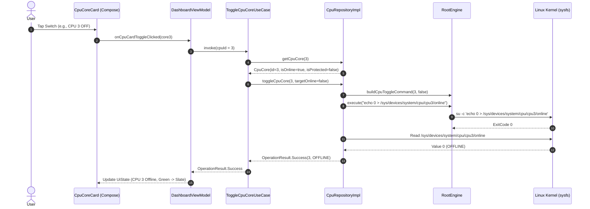

# Core Control — System Architecture Documentation

**Core Control** is an enterprise-grade Android system utility engineered under the **SARGAVERSE** brand. Designed specifically for rooted Android platforms (KernelSU, APatch, and Magisk) on modern ARM64 devices such as Xiaomi HyperOS, it provides hardware-level CPU core monitoring and hotplug switching.

---

## 1. Architectural Philosophy: Clean Architecture

The application strictly follows Clean Architecture principles, ensuring complete decoupling between hardware interfaces (`sysfs`), root execution engines (`su`), domain business rules, and UI presentation components (Jetpack Compose).

```
                      +---------------------------------------+
                      |          Presentation Layer           |
                      |   (Jetpack Compose, ViewModels, Theme)|
                      +-------------------+-------------------+
                                          |
                                          v
                      +---------------------------------------+
                      |             Domain Layer              |
                      |      (UseCases, Models, Repositories) |
                      +-------------------+-------------------+
                                          |
                                          v
                      +---------------------------------------+
                      |              Data Layer               |
                      |  (SysfsCpuReader, RootEngine, Prefs)  |
                      +---------------------------------------+
```

---

## 2. Absolute Core Control Rule

The foundational safety guarantee of Core Control is:

> **ONE TAP MUST ONLY CONTROL THE CPU CORE THAT WAS TAPPED.**

### Strict Behavioral Mandates
1. **Target Isolation**: An individual toggle targeting `cpuId` invokes:
   ```bash
   su -c 'echo [0|1] > /sys/devices/system/cpu/cpu<N>/online'
   ```
   No global CPU disable or cluster-wide commands are ever used for individual toggles.
2. **CPU0 Hardware Protection**: CPU0 is the primary system bootstrap core and interrupt handler. The domain use case and repository permanently lock CPU0 into `PROTECTED` state. Deactivation requests are rejected before dispatching any shell process.
3. **Hardware State Re-verification**: Execution success is never inferred from shell exit codes alone. Sysfs `/sys/devices/system/cpu/cpuN/online` is re-read immediately post-execution to confirm actual kernel acceptance.
4. **Operation Serialization**: A Kotlin `Mutex` serializes all hardware-level writes to avoid race conditions and kernel deadlocks.

---

## 3. Data Flow & Operation Sequence



---

## 4. Capability States

Every detected core is assigned an explicit capability state:

| State | Description | Controllable? |
|---|---|---|
| `ONLINE` | Core is active and executing tasks. | Yes |
| `OFFLINE` | Core is in low-power offline state (hotplugged out). | Yes |
| `PROTECTED` | Primary system core (CPU0) locked from deactivation. | No (Always Active) |
| `UNSUPPORTED` | Core missing `/online` sysfs interface (fixed architecture). | No |
| `UNKNOWN` | State could not be read or parsed. | No |
| `ERROR` | Kernel or SELinux denial encountered. | No |

---

## 5. Bulk Operation Safeguards

- **ALL ON**: Activates all eligible offline cores individually, verifying each step.
- **ALL OFF**: Deactivates secondary cores while preserving:
  1. CPU0 (system safety anchor)
  2. At least one execution core per detected cluster (Little, Mid, Prime), ensuring critical threads and scheduler affinities remain stable.

---

## 6. Security & Shell Hardening

1. **Strict Input Sanitization**: CPU IDs are validated via `^[0-9]+$` within `0..127` before forming any shell command string, completely preventing command injection.
2. **Process Timeout**: All root executions enforce strict timeouts (default 5000ms) with forcible destruction of orphaned processes.
3. **SELinux & KernelSU Compatibility**: Designed to run cleanly under KernelSU context (`u:r:ksu:s0`), APatch, and Magisk.
